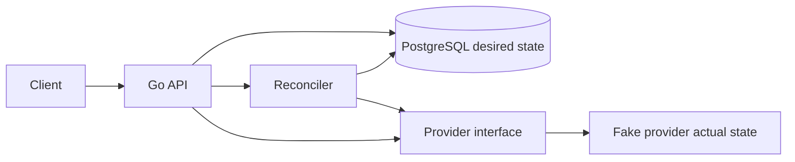

# FleetPilot

[](https://github.com/chrisuzor/fleetpilot/actions/workflows/test.yml)

FleetPilot is a small control plane for a simulated fleet of virtual machines. It stores the fleet you want in PostgreSQL and drives a provider until the fleet you have matches.

This is the first public slice. The provider is an in-process fake. That is the point of the slice: the reconciliation loop is real, and it does not need a cloud account, credentials, or money.

## Architecture



PostgreSQL stores desired instances: name, image, size, and region. The provider stores actual instances. Fetching an instance reads actual state from the provider at that moment. The live spec is not copied back into PostgreSQL.

The reconciler lists both sides and matches them by name:

| Actual state | Action |
| --- | --- |
| No instance with that name | Create |
| Instance exists, spec differs | Update |
| Instance exists, spec matches | Nothing |
| Provider has a name that is not desired | Delete |

Names are unique and immutable. Rename by deleting the desired instance and creating a new one.

Image, size, and region are labels. The fake provider stores them. It does not boot a machine.

```go
type Spec struct {
    Image  string
    Size   string
    Region string
}

type Actual struct {
    ID     string
    Name   string
    Spec   Spec
    Status string
}

type Provider interface {
    Create(ctx context.Context, name string, spec Spec) (Actual, error)
    Update(ctx context.Context, id string, spec Spec) (Actual, error)
    Delete(ctx context.Context, id string) error
    List(ctx context.Context) ([]Actual, error)
}
```

A reconcile run still reads both sides when nothing has changed. If they already match, it does not call `Create`, `Update`, or `Delete`. Actions come back in desired-name order, then deletions by name. If a provider call fails, the run stops after the actions already applied. Call reconcile again. The next run continues from the provider's current state.

Reconcile is serialized inside one API process. Run one API process. This slice has no distributed lock.

## Run

Docker Compose starts the API and PostgreSQL:

```bash
docker compose up --build
```

The API listens on `http://127.0.0.1:8080`. PostgreSQL stays on the Compose network and is not published on the host, so it does not take port 5432 if you already have Postgres locally.

The Compose database user and password are both `fleetpilot`. That is a local development default, not a deployed credential. The database connection inside Compose does not use TLS.

Stop it with `docker compose down`. Add `-v` to drop the database volume.

`GET /healthz` returns `{"status":"ok"}` when the API can reach PostgreSQL.

## Example requests

Create stores desired state only. `actual` is null until reconcile runs.

```bash
curl -sS -X POST http://127.0.0.1:8080/v1/instances \
  -H 'content-type: application/json' \
  -d '{"name":"web-1","image":"ubuntu-24.04","size":"small","region":"local"}'
```

```json
{
  "id": "inst_0123456789abcdef",
  "name": "web-1",
  "desired": {"image": "ubuntu-24.04", "size": "small", "region": "local"},
  "actual": null,
  "in_sync": false,
  "created_at": "2026-10-26T18:00:00Z",
  "updated_at": "2026-10-26T18:00:00Z"
}
```

Get the same instance. Use the `id` from the create response.

```bash
curl -sS http://127.0.0.1:8080/v1/instances/inst_0123456789abcdef
```

Reconcile creates the provider instance.

```bash
curl -sS -X POST http://127.0.0.1:8080/v1/reconcile
```

```json
{
  "actions": [
    {"op": "create", "name": "web-1", "provider_id": "vm_0123456789abcdef"}
  ]
}
```

Get it again. `in_sync` is true when the provider spec matches the desired spec.

```bash
curl -sS http://127.0.0.1:8080/v1/instances/inst_0123456789abcdef
```

```json
{
  "id": "inst_0123456789abcdef",
  "name": "web-1",
  "desired": {"image": "ubuntu-24.04", "size": "small", "region": "local"},
  "actual": {
    "id": "vm_0123456789abcdef",
    "image": "ubuntu-24.04",
    "size": "small",
    "region": "local",
    "status": "running"
  },
  "in_sync": true
}
```

Reconcile again. Nothing changed, so the run is a no-op:

```bash
curl -sS -X POST http://127.0.0.1:8080/v1/reconcile
```

```json
{"actions": []}
```

Ids and timestamps above are examples. `curl` prints compact JSON.

To change a spec, patch the desired row and reconcile:

```bash
curl -sS -X PATCH http://127.0.0.1:8080/v1/instances/inst_0123456789abcdef \
  -H 'content-type: application/json' \
  -d '{"image":"ubuntu-24.04","size":"medium","region":"local"}'

curl -sS -X POST http://127.0.0.1:8080/v1/reconcile
```

The reconcile response is an `update` action. A second call returns `{"actions":[]}`.

To remove an instance, delete the desired row, then reconcile. The next run returns a `delete` action. The run after that is empty.

```bash
curl -sS -X DELETE http://127.0.0.1:8080/v1/instances/inst_0123456789abcdef
curl -sS -X POST http://127.0.0.1:8080/v1/reconcile
```

`GET /v1/instances` lists desired instances with the actual state joined in.

## Trade-off

The fake provider is the point of this slice. FleetPilot's job is to remember desired state and converge actual state. An in-memory provider proves that loop — create, update, delete, and a second run that changes nothing — without Docker in the unit tests and without cloud credentials.

The cost is that this slice does not provision real infrastructure. Quotas, cloud error shapes, and instance boot time are not exercised. Actual instances live only in the API process. Restarting the API clears them. Desired rows remain in PostgreSQL, and the next reconcile creates any that are missing. A later provider implements the same `Provider` interface, and the reconciler stays as it is.

The API does not authenticate callers. Keep it on localhost.

## Tests

Unit tests use the in-memory store and the fake provider. They do not start PostgreSQL, Docker, or a cloud client. The module requires Go 1.25.

```bash
go test ./...
```

GitHub Actions runs `go test -race ./...` on every push. That job does not start PostgreSQL. `docker compose up --build` is how you run the Postgres path.

## Configuration

| Variable | Required | Default | Purpose |
| --- | --- | --- | --- |
| `DATABASE_URL` | yes | | PostgreSQL URL for desired state |
| `PORT` | no | `8080` | API port |

Compose sets both. There is no provider switch in this slice. The process always uses the fake provider.

## Not in this slice

Kubernetes, Terraform, OpenTelemetry, Prometheus, authentication, and a job queue are intentionally absent.

## License

[MIT](LICENSE)
