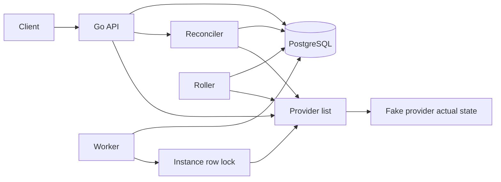

# FleetPilot

[](https://github.com/chrisuzor/fleetpilot/actions/workflows/test.yml)

FleetPilot is a small control plane for a simulated fleet of virtual machines. It stores the fleet you want in PostgreSQL and drives a provider until the fleet you have matches.

The provider is an in-process fake. That is the point: the control loop is real, and it does not need a cloud account, credentials, or money. Reconcile enqueues a job. A worker applies that job to the fake provider. A rolling update changes one instance at a time and pauses when a health check fails.

## Architecture



PostgreSQL stores desired instances: name, image, size, and region. It also stores provisioning jobs, health checks, rollouts, and one lock row per instance name. The provider stores actual instances. Fetching an instance reads actual state from the provider at that moment. The live spec is not copied back into PostgreSQL. The latest health check is.

Reconcile lists both sides and matches them by name. It does not call `Create`, `Update`, or `Delete`. It enqueues one job per difference:

| Actual state | Job |
| --- | --- |
| No instance with that name | `create` |
| Instance exists, spec differs | `update` |
| Instance exists, spec matches | Nothing |
| Provider has a name that is not desired | `delete` |

A second reconcile with no spec change enqueues nothing and returns `{"jobs":[]}`. At most one pending or running job exists per instance name. Reconcile of the same pending job is not a new job.

The API process starts a worker. The worker claims a ready job, takes the instance lock, and applies it. At most four jobs are in flight in one process.

Names are unique and immutable. Rename by deleting the desired instance and creating a new one.

Image, size, and region are labels. The fake provider stores them. It does not boot a machine.

```go
type Provider interface {
    Create(ctx context.Context, name string, spec Spec) (Actual, error)
    Update(ctx context.Context, id string, spec Spec) (Actual, error)
    Delete(ctx context.Context, id string) error
    List(ctx context.Context) ([]Actual, error)
}
```

### Idempotency

Replaying a job does not double-create or double-delete. Before `Create`, the worker lists the provider. A name that already exists is success, and `Create` is not called. Before `Delete`, a name that is already absent is success, and `Delete` is not called. An update whose spec already matches is a no-op.

A running job whose row has not moved for 30 seconds can be claimed again. The replay uses the same checks, so a crash between a successful provider call and marking the job succeeded does not create a second instance.

### Retries

Only a provider error increments the attempt count. The wait after failure `n` (1-based) is `min(5s, 100ms * 2^(n-1))`. With the defaults that is 100ms, 200ms, 400ms, then 800ms. The fifth provider failure marks the job `dead`. It is not claimed again. A later reconcile that still sees drift enqueues a new job.

A lock that is already held, or a cancelled worker, puts the job back to `pending` with the same attempt count. It becomes ready again after one poll, 50ms. That wait is not backoff.

### Instance lock

Before the provider call, the worker opens a transaction, inserts the instance name into `instance_locks` if it is not there, and selects that row `FOR UPDATE SKIP LOCKED`. The transaction stays open for the provider call and ends when the call returns. The row lock releases on commit or rollback.

If another transaction already holds the row, `SKIP LOCKED` returns no row. The worker does not call the provider. Two API processes cannot apply the same instance at once. Different names are different rows, so they run together, up to the in-flight limit.

### Health checks

`POST /v1/instances/{id}/health` asks the provider and stores the result. `GET /v1/instances/{id}/health` returns the newest stored check. Instance responses include that check, or `null` when none has been stored.

A running fake instance is `healthy`. An instance that is not in the provider yet is `unhealthy` with detail `not running`.

### Rolling update

`POST /v1/rollouts` snapshots the desired names in name order and stores the new spec. The roller then handles one name at a time:

1. Write the new spec onto that desired instance and enqueue one update job.
2. Wait until that job succeeds.
3. Store a health check.
4. A `healthy` check moves to the next name. An `unhealthy` check sets the rollout to `paused` with `pause_reason` `health check failed`.

The pause leaves every later instance on its old spec. Instances already updated stay on the new spec, including the one whose check failed. Another step does not continue the rollout. One running rollout is allowed at a time.

A job that reaches `dead` also pauses the rollout, with `pause_reason` `job dead`, and does not change the next instance. Provider errors still use the retry backoff above. The fifth failure is what marks the job dead.

## Run

Docker Compose starts the API and PostgreSQL:

```bash
docker compose up --build
```

The API listens on `http://127.0.0.1:8080`. PostgreSQL stays on the Compose network and is not published on the host, so it does not take port 5432 if you already have Postgres locally.

The Compose database user and password are both `fleetpilot`. That is a local development default, not a deployed credential. The database connection inside Compose does not use TLS.

Stop it with `docker compose down`. Add `-v` to drop the database volume.

`GET /healthz` returns `{"status":"ok"}` when the API can reach PostgreSQL.

## Example requests

Create stores desired state only. `actual` is null until the worker finishes the job.

```bash
curl -sS -X POST http://127.0.0.1:8080/v1/instances \
  -H 'content-type: application/json' \
  -d '{"name":"web-1","image":"ubuntu-24.04","size":"small","region":"local"}'
```

```json
{
  "id": "inst_0123456789abcdef",
  "name": "web-1",
  "desired": {"image": "ubuntu-24.04", "size": "small", "region": "local"},
  "actual": null,
  "in_sync": false,
  "health": null,
  "created_at": "2026-10-26T18:00:00Z",
  "updated_at": "2026-10-26T18:00:00Z"
}
```

Get the same instance. Use the `id` from the create response.

```bash
curl -sS http://127.0.0.1:8080/v1/instances/inst_0123456789abcdef
```

Reconcile enqueues a create job. The worker applies it.

```bash
curl -sS -X POST http://127.0.0.1:8080/v1/reconcile
```

```json
{
  "jobs": [
    {
      "id": "job_0123456789abcdef",
      "name": "web-1",
      "op": "create",
      "status": "pending",
      "attempts": 0,
      "last_error": "",
      "run_after": "2026-10-26T18:00:00Z"
    }
  ]
}
```

Read the job. `status` becomes `succeeded` when the provider call finishes.

```bash
curl -sS http://127.0.0.1:8080/v1/jobs/job_0123456789abcdef
```

Get the instance again. `in_sync` is true when the provider spec matches the desired spec.

```bash
curl -sS http://127.0.0.1:8080/v1/instances/inst_0123456789abcdef
```

```json
{
  "id": "inst_0123456789abcdef",
  "name": "web-1",
  "desired": {"image": "ubuntu-24.04", "size": "small", "region": "local"},
  "actual": {
    "id": "vm_0123456789abcdef",
    "image": "ubuntu-24.04",
    "size": "small",
    "region": "local",
    "status": "running"
  },
  "in_sync": true,
  "health": null
}
```

Reconcile again. Nothing changed, so no job is enqueued:

```bash
curl -sS -X POST http://127.0.0.1:8080/v1/reconcile
```

```json
{"jobs": []}
```

Ids and timestamps above are examples. `curl` prints compact JSON. The API returns timestamps in UTC.

To change a spec, patch the desired row and reconcile. The response is an `update` job. After the worker finishes, a second reconcile returns `{"jobs":[]}`.

```bash
curl -sS -X PATCH http://127.0.0.1:8080/v1/instances/inst_0123456789abcdef \
  -H 'content-type: application/json' \
  -d '{"image":"ubuntu-24.04","size":"medium","region":"local"}'

curl -sS -X POST http://127.0.0.1:8080/v1/reconcile
```

To remove an instance, delete the desired row, then reconcile. The response is a `delete` job. The reconcile after the worker finishes is empty.

```bash
curl -sS -X DELETE http://127.0.0.1:8080/v1/instances/inst_0123456789abcdef
curl -sS -X POST http://127.0.0.1:8080/v1/reconcile
```

`GET /v1/instances` lists desired instances with the actual state and the latest health check joined in.

Check an instance after the worker has created it:

```bash
curl -sS -X POST http://127.0.0.1:8080/v1/instances/inst_0123456789abcdef/health
```

```json
{
  "id": "chk_0123456789abcdef",
  "status": "healthy",
  "detail": "running",
  "checked_at": "2026-10-26T18:00:00Z"
}
```

Roll `web-1`, `web-2`, and `web-3` to `medium` one at a time. With `web-2` unhealthy, the rollout pauses after `web-2` and leaves `web-3` on the old spec:

```bash
curl -sS -X POST http://127.0.0.1:8080/v1/rollouts \
  -H 'content-type: application/json' \
  -d '{"image":"ubuntu-24.04","size":"medium","region":"local"}'
```

```json
{
  "id": "roll_0123456789abcdef",
  "status": "paused",
  "pause_reason": "health check failed",
  "spec": {"image": "ubuntu-24.04", "size": "medium", "region": "local"},
  "instances": [
    {"name": "web-1", "state": "updated"},
    {"name": "web-2", "state": "failed"},
    {"name": "web-3", "state": "pending"}
  ]
}
```

`GET /v1/rollouts/roll_0123456789abcdef` returns the same shape. The response above is the paused rollout. The create response is `running` until the roller finishes the checks.

## Trade-off

The fake provider is the point. FleetPilot's job is to remember desired state and converge actual state. An in-memory provider proves that loop — enqueue, apply, retry, and a second reconcile that enqueues nothing — without Docker in the unit tests and without cloud credentials.

The cost is that this does not provision real infrastructure. Quotas, cloud error shapes, and instance boot time are not exercised. Actual instances live only in the API process. Restarting the API clears them, including which names fail a health check. Desired rows, job history, health checks, and rollouts remain in PostgreSQL. The next reconcile enqueues creates for anything missing, and a new rollout reads health from the provider again. A later provider implements the same `Provider` interface. The reconciler still only enqueues, and the worker still applies.

The API does not authenticate callers. Keep it on localhost.

## Tests

Unit tests use an in-memory queue, an in-memory lock, and the fake provider. They do not start PostgreSQL, Docker, or a cloud client. Failure-injection tests make the fake provider return an error. The job retries with the backoff above, then succeeds, or becomes `dead` on the fifth failure. A failed health check stops a rolling update. The module requires Go 1.25.

```bash
go test -race ./...
```

GitHub Actions runs that command on every push. The job does not start PostgreSQL. `docker compose up --build` is how you run the Postgres path, including the row lock.

## Configuration

| Variable | Required | Default | Purpose |
| --- | --- | --- | --- |
| `DATABASE_URL` | yes | | PostgreSQL URL for desired state, jobs, health checks, and rollouts |
| `PORT` | no | `8080` | API port |

Compose sets both. There is no provider switch. The process always uses the fake provider. The worker runs with four in-flight jobs, five attempts, a 100ms base delay, a 5s cap, and a 50ms poll.

## Not in this slice

Kubernetes, Terraform, OpenTelemetry, Prometheus, audit logs, and authentication are intentionally absent.

## License

[MIT](LICENSE)
