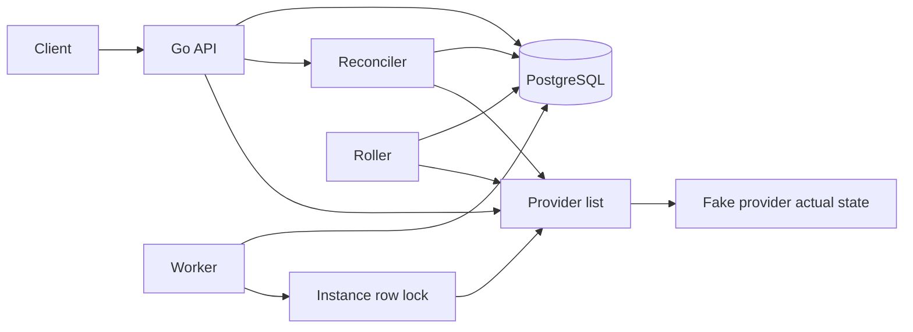

# FleetPilot architecture

26 October 2026, Africa/Lagos (UTC+1)

Repository: [github.com/chrisuzor/fleetpilot](https://github.com/chrisuzor/fleetpilot)

FleetPilot is a small control plane for a simulated fleet. It stores the fleet you want in PostgreSQL and drives a provider until the fleet you have matches. The provider is an in-process fake. It does not create real virtual machines, and it does not call a cloud API.

This article describes the code on `main`. It is not a production report. There are no measured production numbers here, and the rollout below is a rolling update, not a canary.

## The problem

A control plane has two copies of the world. Desired state is what an operator asked for. Actual state is what the provider currently has. Those copies drift. A create can succeed in the provider and fail before the database records it. Two workers can apply the same instance. A bad update can move every instance before anyone notices.

FleetPilot is the smallest loop that still has those problems: remember desired state, compare it with actual state, enqueue the difference, apply it once, retry provider errors, and stop a rollout when a health check fails.

The point of the project is that loop. A cloud account would hide it behind quotas, credentials, and boot time.

## Constraints

- The provider is fake and in-process. Image, size, and region are labels. Nothing boots.
- No real virtual machines, no cloud account, and no paid provider.
- Unit tests do not start PostgreSQL, Docker, or a trace collector. `go test -race ./...` is the check that runs on every push.
- The API is meant to stay on localhost. The role header is a label, not a credential.
- Kubernetes manifests and OpenTofu describe a local layout. Apply is optional. GitHub Actions validates the module and does not apply it. The API image build is not pushed to a registry.
- The local database user and password are both `fleetpilot`. That is a development default, not a deployed credential.

## Architecture

PostgreSQL holds desired instances, jobs, health checks, rollouts, the audit log, and one lock row per instance name. The fake provider holds actual instances in the API process. A read joins them at request time. The live spec is not copied back into PostgreSQL. The latest health check is.

Names are the match key. They are unique and immutable. Image, size, and region are the spec. Rename by deleting the desired row and creating a new one.

`Provider` is `Create`, `Update`, `Delete`, and `List`. `Checker` is a separate `Check`. The fake implements both. A later provider can implement the same interfaces. The reconciler would still only enqueue, and the worker would still apply.

The API process starts one worker and one roller. Reconcile does not call the provider's mutating methods. It lists both sides and enqueues one job per difference:

| Actual state | Job |
| --- | --- |
| No instance with that name | `create` |
| Instance exists, spec differs | `update` |
| Instance exists, spec matches | Nothing |
| Provider has a name that is not desired | `delete` |

A second reconcile with no spec change returns `{"jobs":[]}`. At most one pending or running job exists per instance name. Reconcile of the same pending work is not a new job.

The worker claims a ready job, takes the instance lock, and applies it. At most four jobs are in flight in one process. Default retry is five attempts, a 100ms base, a 5s cap, and a 50ms poll. After failures 1 through 4 the waits are 100ms, 200ms, 400ms, and 800ms. The fifth provider failure marks the job `dead`. A later reconcile that still sees drift enqueues a new job.

Replaying a job does not double-create or double-delete. Before `Create`, the worker lists the provider. A name that already exists is success, and `Create` is not called. Before `Delete`, a name that is already absent is success. An update whose spec already matches is a no-op. A running job that has not moved for 30 seconds can be claimed again. The same checks cover a crash between a successful provider call and marking the job succeeded.

The lock is a Postgres row. The worker inserts the instance name into `instance_locks` if needed and selects it `FOR UPDATE SKIP LOCKED`. The transaction stays open for the provider call. If another transaction holds the row, the worker does not call the provider and does not burn an attempt. The job returns to `pending` and is ready again after one poll. Different names are different rows, so they run together, up to the in-flight limit.

### Health and rolling update

`POST /v1/instances/{id}/health` asks the checker and stores the result. A running fake instance is `healthy` with detail `running`. An instance that is not in the provider yet is `unhealthy` with detail `not running`. Instance responses include the newest stored check, or `null` when none has been stored.

`POST /v1/rollouts` snapshots desired names in name order and stores the new spec. This is a rolling update. It is not a canary: there is no traffic split and no subset left on the old spec on purpose while the rest stay put for comparison. The roller handles one name at a time:

1. Write the new spec onto that desired instance and enqueue one update job.
2. Wait until that job succeeds.
3. Store a health check.
4. A `healthy` check moves to the next name. An `unhealthy` check pauses the rollout with `pause_reason` `health check failed`.

The pause leaves every later instance on its old spec. Instances already updated stay on the new spec, including the one whose check failed. A paused rollout is not resumed by another step. A `dead` job pauses with `pause_reason` `job dead` and does not change the next instance. An empty fleet is stored as `succeeded`. A second rollout while one is `running` is rejected.

### Audit, roles, and signals

The audit log is append-only. Instance creates, updates, and deletes, and reconciles, are stored with the caller role. The worker stores `job.succeeded` and `job.dead`. The roller stores `rollout.pause`. `GET /v1/audit` returns the newest rows.

Every `/v1` request sends `X-FleetPilot-Role: reader` or `X-FleetPilot-Role: operator`. A missing or unknown value is `401`. A reader on an operator route is `403`. A reader can list and get instances, read health, and read the audit log. An operator can also create, update, delete, check health, reconcile, read a job, and start or read a rollout. There is no token. `GET /healthz` and `GET /metrics` do not read the header.

`GET /metrics` exposes four series: HTTP requests, reconcile runs, job outcomes (`succeeded` or `dead`), and in-flight jobs. Those counters describe the process. They are not a production measurement. A reconcile request and the worker that applies its job share a trace, linked by the W3C `traceparent` stored on the job. The default exporter writes spans to stdout. `none` or `OTEL_SDK_DISABLED=true` turns tracing off. Any other exporter value, including `otlp`, is ignored and still writes to stdout, so a missing collector is not dialed.

### How it runs

Docker Compose runs the API and PostgreSQL. The API listens on `127.0.0.1:8080`. Postgres is not published on the host.

`deploy/kubernetes/` runs the same two processes in the `fleetpilot` namespace: one Postgres pod and one API replica. Both services are ClusterIP. The API image is `fleetpilot:local` and is not pulled from a registry. One replica is a constraint, not a tuning choice: actual instances live in that process. A second replica would have its own fake provider. OpenTofu in `deploy/tofu/` describes those manifests. `tofu validate` does not need a cluster. `tofu apply` does not create a cluster, a load balancer, or a virtual machine.

GitHub Actions runs the race tests, golangci-lint, `tofu validate`, and `docker build`. The image is not pushed.

## Trade-offs

The fake provider is the point. The loop — enqueue, apply, retry, and a second reconcile that enqueues nothing — runs without Docker in the unit tests and without cloud credentials. The cost is that quotas, cloud error shapes, and instance boot time are not exercised. Restarting the API clears actual instances, including which names fail a health check. Desired rows, job history, health checks, and rollouts remain in PostgreSQL. The next reconcile enqueues creates for anything missing.

The role header is not an identity provider. Anyone who can reach the port can claim `operator`. That is acceptable only while the API stays on localhost. The same is true of `/metrics` and `/healthz`.

Stdout traces stay in the process logs. They are not shipped. That avoids a collector for local development. It also means a trace dies with the terminal.

The Postgres row lock is real, and the tests that do not start Postgres use an in-memory lock with the same contract. The SQL path is what Compose and an optional local apply exercise. CI does not start a database and does not apply the manifests.

A rolling update that pauses is easier to reason about than one that keeps going. It is also incomplete: the failed instance stays on the new spec, later instances stay on the old spec, and nothing in the API resumes the paused rollout.

## What I would improve

I would add a second provider behind the same `Provider` and `Checker` interfaces, still without treating the fake as optional inside this repository's default path until that provider exists. Actual state would then survive a process restart, and more than one API replica would mean something. The row lock is already there so two appliers cannot apply the same name.

I would let an operator resume a paused rollout from the next name, or roll the failed instance back, instead of leaving the fleet split. I would keep it a rolling update. I would not turn it into a canary.

I would replace the role header with a real identity check before the port is reachable beyond localhost, and I would keep `/healthz` as a process probe. I would send traces to a collector only when one is configured, and I would leave the stdout default so local development still needs nothing else.

I would keep CI from applying to a cluster or pushing an image. An integration test against Postgres would cover the row lock on the path unit tests skip. That is a test gap, not a change to the control loop.
